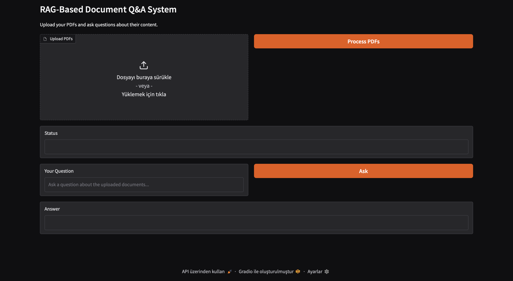

# RAG Document Q&A Service

A production-style retrieval-augmented generation (RAG) service for
source-attributed question answering over PDF documents. Built with LangChain,
FAISS, and Google Gemini, served behind a FastAPI API, and shipped with
experiment tracking, monitoring, tests, and CI.



---

## Overview

The service ingests PDFs, builds a FAISS vector index over Gemini embeddings, and
answers natural-language questions using only the retrieved context, returning
the source document and page for every answer. Beyond the core pipeline, it is
wrapped as a real service: a FastAPI API with request validation, RAGAS-based
evaluation, MLflow experiment tracking, Prometheus and Grafana monitoring, a
pytest suite, and a GitHub Actions CI pipeline.

---

## Features

- **Source-attributed answers.** Every response includes the originating
  document and page; the prompt is constrained to answer only from retrieved
  context and to say so when the answer is not present.
- **Configurable retrieval.** Chunk size, chunk overlap, and top-k are
  parameters, so retrieval behaviour can be tuned and compared.
- **FastAPI service.** Typed endpoints with Pydantic validation, a vector store
  loaded once at startup, and a Gradio UI mounted on the same app.
- **Evaluation harness.** A labelled 51-question set over public NIST documents,
  with retrieval metrics (hit@k, recall@k, MRR) and RAGAS faithfulness and
  answer relevancy; see [Evaluation](#evaluation).
- **Experiment tracking.** MLflow logs retrieval parameters, latency, and
  evaluation metrics for every run.
- **Monitoring.** The API exposes Prometheus metrics, Prometheus scrapes them,
  and Grafana is included in the stack for building dashboards over them.
- **Tested and CI-backed.** pytest covers the API contracts and error paths;
  GitHub Actions runs the tests and builds the Docker image on every push.

---

## Architecture

The stack runs as four services via Docker Compose:

| Service     | Role                                              | Port |
| ----------- | ------------------------------------------------- | ---- |
| api         | FastAPI app (RAG pipeline, REST API, Gradio UI)   | 8000 |
| mlflow      | MLflow tracking server (SQLite backend store)     | 5001 |
| prometheus  | Scrapes API metrics                               | 9090 |
| grafana     | Dashboards over Prometheus                        | 3000 |


---

## Pipeline

1. PDFs are loaded and split into chunks with a recursive character splitter.
2. Chunks are embedded with Gemini embeddings and stored in a FAISS index.
3. A query retrieves the top-k chunks, which are passed to Gemini under a strict
   context-grounded prompt.
4. The answer is returned with its source documents and pages, and the run is
   logged to MLflow.

---

## API

| Method | Endpoint   | Description                                            |
| ------ | ---------- | ----------------------------------------------------- |
| GET    | `/health`  | Service status and whether the vector store is loaded |
| POST   | `/ingest`  | Build the index from PDFs (configurable chunking)     |
| POST   | `/query`   | Ask a question; returns answer, sources, and latency  |
| GET    | `/metrics` | Prometheus metrics                                    |
| GET    | `/ui`      | Gradio interface                                      |

Example query:

```bash
curl -X POST http://localhost:8000/query \
  -H "Content-Type: application/json" \
  -d '{"question": "What dataset was used for training?", "k": 7}'
```

---

## Evaluation

`rag_eval/` evaluates the pipeline on three public-domain NIST publications
(AI RMF 1.0, the Generative AI Profile AI 600-1, CSF 2.0; 144 pages, 464 chunks
at the default chunk size).

- **Questions.** 51 questions in `rag_eval/questions.json`: 46 answerable ones
  (facts, definitions, lists, identifier lookups, 4 multi-hop across documents)
  and 5 unanswerable ones that test refusal. 14 are reworded to share few words
  with their evidence and are reported separately.
- **Labels.** Each answer is labelled with its page and verbatim evidence text,
  not chunk ids, because chunk boundaries change with chunk size. A retrieved
  chunk counts as relevant when it contains at least half of an evidence span.
  `python rag_eval/labels.py` checks every label against the corpus.
- **Metrics.** hit@k, recall@k (share of evidence items found, so multi-hop
  questions need all of them) and MRR over the top 10; RAGAS faithfulness and
  answer relevancy on the generated answers; refusal rates.

Baseline (the API's defaults: chunk 1000/200, Gemini embeddings, FAISS, k = 5):

| Questions | n | hit@1 | hit@5 | recall@10 | MRR |
|---|---|---|---|---|---|
| All answerable | 46 | 0.50 | 0.85 | 0.91 | 0.63 |
| Reworded | 14 | 0.57 | 0.86 | 0.93 | 0.67 |
| Identifier lookups | 7 | 0.43 | 0.57 | 0.86 | 0.51 |
| Multi-hop | 4 | 0.50 | 0.75 | 0.75 | 0.60 |

| Faithfulness | Answer relevancy | Unanswerable refused | Answerable refused |
|---|---|---|---|
| 0.96 (41 answered) | 0.67 | 5 / 5 | 5 / 46 |

Identifier lookups ("What does GV-1.3-007 recommend?") are the weakest case for
dense retrieval. Four of the five false refusals follow a retrieval miss; the
fifth is a multi-hop question where only one of its two passages was retrieved. Rewording
questions did not hurt dense retrieval at this sample size. Full per-question
output is in `rag_eval/results/baseline.json`.

```bash
python rag_eval/download_corpus.py   # once; checksums pin the PDFs
python -m rag_eval.run               # writes rag_eval/results/<name>.{json,md}, logs to MLflow if running
```

Every Gemini call is cached in `rag_eval/cache.sqlite` under a hash of its
input, so rerunning a configuration costs no API calls.

**Limitations.**
- The judge is the answer model itself (`gemini-3.1-flash-lite`): the free
  tier allows the stronger `gemini-3.5-flash` only 20 requests a day, against
  ~230 judge calls per configuration. A model grading its own answers is a
  known bias, and spot checks show judge errors (a correct "Tier 4 (Adaptive)"
  scored faithfulness 0).
- Faithfulness checks agreement with the retrieved context, not correctness: an
  answer built on the wrong chunks can still score 1.0. Refusals are excluded
  from it, since the judge scored identical refusals both 0 and 1.
- RAGAS answer relevancy penalises very short answers, which the app's prompt
  asks for, so its absolute value is low by construction.
- 46 answerable questions over one domain; differences of a few points between
  configurations are within noise. The questions were drafted by an LLM and
  reviewed by hand.
- The eval answers at temperature 0; the app uses 0.3.

---

## Running

### With Docker Compose

```bash
cp .env.example .env        # add your GOOGLE_API_KEY
docker compose up --build
```

This starts the API, MLflow, Prometheus, and Grafana. The API is available at
`http://localhost:8000` (UI at `/ui`), MLflow at `http://localhost:5001`, and
Grafana at `http://localhost:3000`.

### Local development

```bash
python -m venv venv
source venv/bin/activate      # Windows: venv\Scripts\activate
pip install -r requirements.txt

cp .env.example .env          # add your GOOGLE_API_KEY
uvicorn api:app --reload --port 8000
```

---

## Testing and CI

```bash
PYTHONPATH=. pytest tests/ -v
```

GitHub Actions runs the test suite on every push and pull request to `main`, and
builds the Docker image once tests pass.

---

## Tech stack

LangChain, FAISS, Google Gemini (gemini-3.1-flash-lite for answers, gemini-embedding-001 for embeddings), FastAPI, Gradio, Pydantic,
RAGAS, MLflow, Prometheus, Grafana, Docker and Docker Compose, GitHub Actions,
pytest.

---

## Configuration

Create a `.env` file from `.env.example`:

```
GOOGLE_API_KEY=your_api_key_here
```

Get an API key from Google AI Studio.